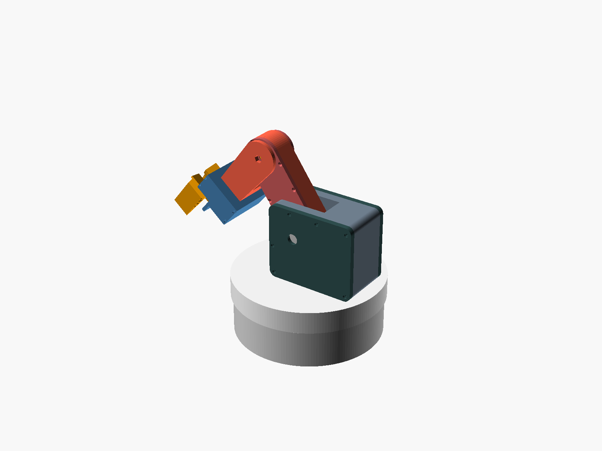
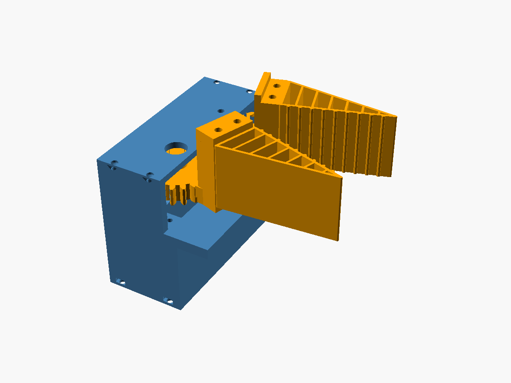

# Roboterarm AM-R1 – Version 2 (geschlossen, 500 g)

Komplett 3D-gedruckter Roboterarm mit Fin-Ray-Greifer aus TPU (Prinzip wie bei Festo).
Mechanik und Elektrik liegen in geschlossenen Gehäusen. Er läuft vollautomatisch ein Programm ab,
gesteuert vom **Freenove ESP32-S3** (Kit FNK0082).



| Eigenschaft | Wert |
|---|---|
| Nutzlast | **500 g bis 22 cm Reichweite**, darüber weniger |
| Drehung | ±200°, Nullpunkt über Lichtschranke |
| Reichweite | etwa 140–260 mm vom Drehpunkt |
| Schulter / Ellbogen | DS3218 (270°) mit Zahnrädern 1:2, also etwa 36 kg·cm am Gelenk |
| Greifer | MG996R, Fin-Ray-Finger aus TPU mit Griffnoppen |
| Lagerung | 11 Kugellager 6801-2RS, jede Gelenkwelle sitzt auf 2 Lagern |
| Standfestigkeit | Basis Ø 220 mm mit etwa 1,7 kg Sand |

### Warum so gebaut?
- **Die Servos treiben nur an, sie tragen nicht.** Die Gelenkwellen laufen in Kugellagern im Gehäuse. Ein Servo hat Zahnräder aus Metall, aber nur ein kleines Lager an der Welle. Seitliche Last durch 500 g würde es schnell ausleiern.
- **Zahnräder 1:2** verdoppeln die Kraft. Mit 270°-Servos bleiben trotzdem 135° Bewegung pro Gelenk.
- **Beide Gelenkservos sitzen hinten im Schultergehäuse** und wirken dort als Gegengewicht. Der Ellbogen wird über eine Koppelstange **im Oberarm-Kasten** bewegt, deshalb trägt der Arm kein Motorgewicht.
- **Kastenbauweise:** Ein geschlossener Kasten ist viel steifer als eine flache Platte. Außerdem ist so alles abgedeckt.

---

## 1. Was du brauchst

### Kaufen (etwa 60 €)
| Teil | Menge | ca. Preis |
|---|---|---|
| Servo **DS3218MG, Ausführung 270°** (mit Alu-Servoscheibe) | 2 | 26 € |
| Servo **MG996R** (Greifer) | 1 | 5 € |
| Kugellager **6801-2RS** (12 × 21 × 5), 10er-Pack | 1–2 | 7 € |
| Netzteil **5 V / 5 A** mit DC-Buchsen-Adapter | 1 | 10 € |
| Schraubensortiment M3 mit **Senkkopf** (8–45 mm), Muttern, Stoppmuttern, Scheiben | 1 | 8 € |
| TPU 95A Filament | 1 Rolle | 20 € |
| Elko 1000 µF / 10 V | 1 | 0,30 € |
| Sand oder Kies, etwa 1,7 kg | | 0 € |

Du brauchst **11 Lager 6801**. Zähl nach, wie viele du schon hast.

### Aus dem Freenove-Kit
ESP32-S3, Breadboard, Kabel, Schrittmotor 28BYJ-48 + ULN2003, LED, Fotowiderstand, Widerstände 220 Ω und 10 kΩ, Taster.

---

## 2. Druckteile

Alle Dateien liegen in `stl/`, sind richtig ausgerichtet und drucken **ohne Stützen**.

| Datei | Anzahl | Material | Einstellungen |
|---|---|---|---|
| `basis.stl` | 1 | PLA | 15 % Füllung, 3 Wände |
| `deckelring.stl` | 1 | PETG | 30 % |
| `rollenachse.stl` | 4 | PETG | 100 % |
| `drehteller.stl` | 1 | PETG | 30 %, Oberseite liegt auf dem Bett |
| `ritzel_basis.stl` | 1 | PETG | 100 % |
| `kappe.stl` | 1 | PLA | |
| `gehaeuse_links.stl`, `gehaeuse_rechts.stl` | je 1 | PETG | 20 % Gyroid, 4 Wände |
| `gehaeuse_deckel.stl` | **2** | PETG | 30 % |
| `schulter_ritzel.stl` | 2 | PETG | 100 % |
| `schulter_zahnrad.stl` | 2 | PETG | 100 % |
| `achse_schulter.stl`, `achse_kurbel.stl`, `achse_ellbogen.stl`, `achse_stummel.stl` | je 1 | PETG | 100 %, liegend |
| `distanzring_1.stl`, `distanzring_1_5.stl` | je 2 | PETG | |
| `oberarm_kasten.stl`, `oberarm_deckel.stl` | je 1 | PETG | 5 Wände, 40 % Gyroid |
| `kurbel.stl` | **2** | PETG | 100 % |
| `koppelstange.stl` | 1 | PETG | 100 % |
| `unterarm_kanal.stl`, `unterarm_deckel.stl` | je 1 | PETG | 5 Wände, 40 % |
| `greifer_gehaeuse.stl`, `greifer_boden.stl`, `greifer_haube.stl` | je 1 | PETG | 4 Wände, 30 % |
| `hebel_antrieb.stl`, `hebel_mitlaeufer.stl` | je 1 | PETG | 100 % |
| `klemmplatte.stl` | 2 | PETG | |
| `finger_tpu.stl` | **2** | **TPU 95A** | siehe unten |

**PETG** ist hier wichtig. Es ist zäher als PLA und kriecht unter Dauerlast weniger, zum Beispiel wenn der Arm 500 g festhält.

**TPU auf der P2S:** von der externen Spule, nicht über das AMS. Profil „Generic TPU“, 25 mm/s, 3 Wandlinien, 0 % Füllung, Bett 35 °C.



---

## 3. Anschlussplan

```
Netzteil 5 V / 5 A
  (+) ── Plus-Schiene ──┬── rot   DS3218 Schulter
                        ├── rot   DS3218 Ellbogen
                        ├── rot   MG996R Greifer
                        ├── (+)   ULN2003
                        └── 5V    ESP32-S3   (nur wenn USB NICHT steckt)
  (-) ── Minus-Schiene ─── braun aller Servos, (-) ULN2003, GND ESP32-S3
         1000 µF Elko zwischen Plus und Minus (langes Bein an Plus)

ESP32-S3   GPIO 4  → Signal DS3218 Schulter      GPIO 15 → IN1 ULN2003
           GPIO 5  → Signal DS3218 Ellbogen      GPIO 16 → IN2
           GPIO 6  → Signal MG996R Greifer       GPIO 17 → IN3
           GPIO 7  → 220 Ω → LED → GND           GPIO 18 → IN4
           3V3 → Fotowiderstand → GPIO 1 → 10 kΩ → GND
           GPIO 14 → Taster → GND (Pause / weiter)
```

Die Servokabel laufen durch die Kanäle im Schultergehäuse, die Mittelsäule und den Kabelkanal der Basis nach außen. Das Greiferkabel verlängerst du mit Stecker-Buchse-Kabeln aus dem Kit. Es läuft durch den Unterarm und die Löcher im Oberarm-Kasten.

---

## 4. Zusammenbau


### Lager einpressen (11 Stück)
| Wo | Anzahl |
|---|---|
| Laufrollen im Deckelring | 4 |
| Innenwände des Schultergehäuses (von der Zahnradseite) | 2 |
| Gehäusedeckel (von innen) | 2 |
| Oberarm-Deckel (Schulter + Ellbogen, von außen) | 2 |
| Unterarm-Deckel (von innen) | 1 |

Lager mit einem Schraubstock oder einer großen Mutter gerade einpressen, nie mit dem Hammer.

### Basis
1. Sand in den äußeren Ring füllen und den `deckelring` mit 6× M3×10 aufschrauben.
2. Laufrollen: Lager zwischen die Böcke halten und die `rollenachse` durchschieben.
3. Schrittmotor mit 2× M3×8 auf die Säulen schrauben und das `ritzel_basis` aufdrücken.
4. Lichtschranke einbauen: Die LED von innen durch das Mittelrohr stecken, den Fotowiderstand von außen in die Säule.

### Oberarm-Kasten
1. `kurbel` (2×) mit `koppelstange` verbinden: M3×20 Senkkopf von der Stangenseite, Stoppmutter auf der Kurbelseite.
2. `achse_schulter` und `achse_stummel` **von innen** durch die Sechskantlöcher der linken Kastenwand stecken. Der Senkkopf sitzt bündig innen.
3. Kurbeln und Stange einlegen: eine Kurbel an der Schulter, eine am Ellbogen, die Stange liegt zur linken Wand.
4. `oberarm_deckel` mit 8× M3×12 Senkkopf aufschrauben.
5. `achse_kurbel` von außen durch das Schulterlager in die Kurbel stecken, `achse_ellbogen` durch das Ellbogenlager in den Hebel.

### Schulter
1. Beide DS3218 in die Taschen der Gehäusehälften setzen, mit 4 Schrauben pro Servo. Die Welle zeigt in den Zahnradraum.
2. `schulter_ritzel` auf die Alu-Servoscheiben schrauben. Durch die Löcher der Scheibe vorbohren, dann mit M3 festschrauben.
3. ESP32 anschließen und `k` senden. Die Servos fahren in die Mitte (135°).
4. Den Kasten einlegen:
   - links: `distanzring_1_5` auf die Achse, dann durch das Innenwandlager
   - rechts genauso über die `achse_kurbel`
5. Die Gehäusehälften mit 4× M3×45 und Muttern verbinden.
6. **Arm ausrichten:** Oberarm **50° über der Waagerechten**, Unterarm **60° schräg nach unten** (absolut). Erst dann die `schulter_zahnrad` auf die Sechskante stecken, sodass sie in die Ritzel greifen.
7. `gehaeuse_deckel` (2×) mit je 6× M3×12 aufschrauben. Auf die Achsenden Scheibe und Stoppmutter setzen.
8. Das Gehäuse von unten mit 4× M3×25 durch den `drehteller` festschrauben. Den Drehteller auf die Säule setzen und die `kappe` aufschrauben.

### Unterarm und Greifer
1. `distanzring_1` auf beide Ellbogen-Achsen.
2. Den `unterarm_kanal` mit dem Sechskantloch auf die `achse_ellbogen` stecken.
3. `unterarm_deckel` über den Stummel setzen, das Lager sitzt im Deckel. Mit 5× M3×12 Senkkopf verschrauben, Scheibe und Stoppmutter auf beide Achsenden.
4. Greifer:
   - MG996R von unten in das `greifer_gehaeuse` schrauben.
   - Die Servoscheibe in den `hebel_antrieb` schrauben und auf das Servo stecken.
   - Den `hebel_mitlaeufer` auf den Zapfen setzen.
   - Die `greifer_haube` mit 4× M3×10 Senkkopf aufschrauben.
   - M3×35 von oben durch Haube, Hebel und Zapfen stecken, Mutter unten in die Sechskanttasche.
   - Mit `k` schließt der Greifer. In dieser Stellung beide Hebel nach vorne ausrichten.
   - Finger mit je 2× M3×40 durch Klemmplatte, Finger und Hebel schrauben. Der zweite Finger kommt umgedreht hinein, die Noppenseite zeigt immer nach innen.
   - Den `greifer_boden` mit 4× M3×10 anschrauben.
5. Den Greifer mit 4× M3×12 an die Stirnwand des Unterarms schrauben, die Muttern sitzen in den Sechskanttaschen.

---

## 5. Firmware

1. Arduino IDE: Board-Paket „esp32“ von Espressif, Bibliotheken **ESP32Servo** und **AccelStepper**.
2. Board **ESP32S3 Dev Module**, „USB CDC On Boot: Enabled“.
3. `firmware/Roboterarm_ESP32S3/Roboterarm_ESP32S3.ino` hochladen.

| Befehl | Prüfen |
|---|---|
| `k` | Servos in die Mitte. Zum Montieren und Ausrichten der Zahnräder. |
| `l` | Lichtschranke: frei etwa 2500–3500, blockiert unter 1000 |
| `t` | Basis dreht +30°. Von oben gesehen gegen den Uhrzeigersinn, sonst `BASIS_RICHTUNG = -1`. |
| `h` | Referenzfahrt, danach zeigt der Arm nach vorne |
| `s` | Ablauf starten |
| `p` / Taster | Pause / weiter |

Die Zahnräder drehen die Drehrichtung um. Fährt ein Gelenk falsch herum, setze `SCHULTER_RICHTUNG` bzw. `ELLBOGEN_RICHTUNG` auf `-1`.
Mit `SCHULTER_TRIMM` und `ELLBOGEN_TRIMM` korrigierst du kleine Winkelfehler.

**Eigene Abläufe:** Im Feld `ablauf[]` steht jede Zeile für einen Punkt.
```cpp
{ basis_grad, reichweite_mm, hoehe_mm, AUF/ZU, pause_ms }
```
Der letzte Punkt sollte bei Basis 0° liegen.

---

## 6. Maße anpassen

Alles steht in `cad/roboterarm.scad`. Bitte nachmessen (Kommentar `MESSEN`):
- `horn_abst`: Ohr-Oberseite bis Fläche der Servoscheibe (DS3218 und MG996R)
- `sv_loch_a`, `sv_loch_b`: Lochabstand der Servo-Ohren
- `horn_d`: Durchmesser der Servoscheibe
- `g_z0`: Höhe der Greifer-Zahnräder
- `sm_welle_l`: Welle des 28BYJ-48

Am besten zuerst `gehaeuse_rechts` und `greifer_gehaeuse` drucken und prüfen, ob die Servos passen.

Ein einzelnes Teil exportierst du so:
```
openscad -D 'teil="unterarm_kanal"' -o unterarm_kanal.stl cad/roboterarm.scad
```
