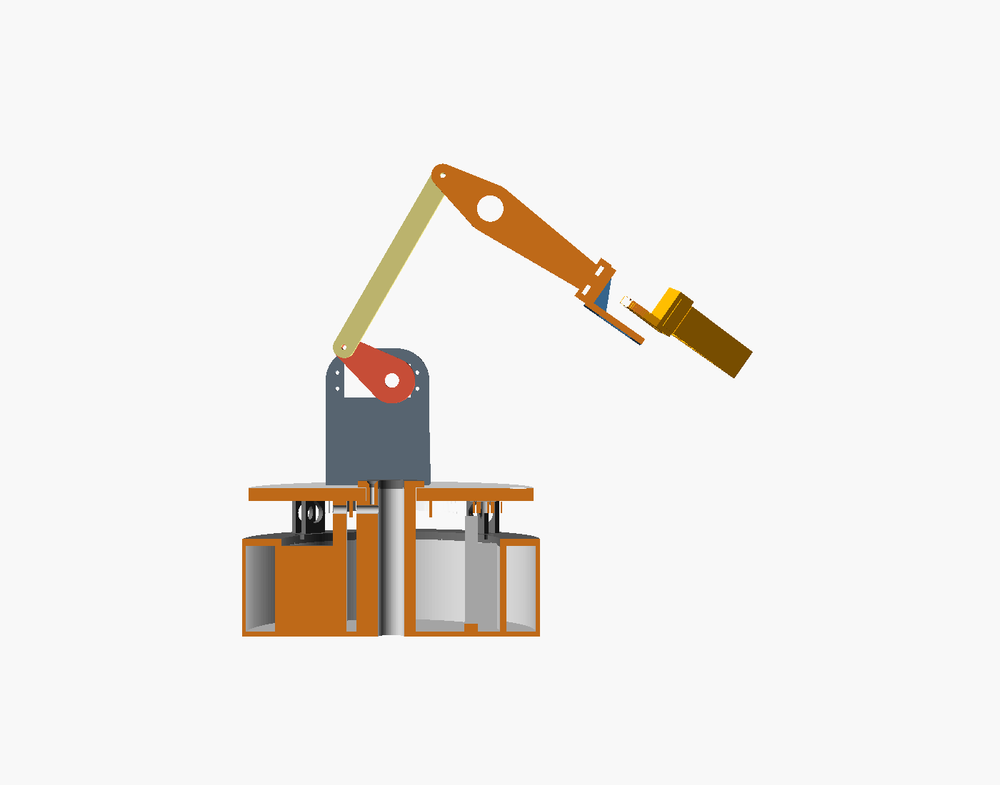

# Roboterarm AM-R1

Komplett 3D-gedruckter Roboterarm mit Fin-Ray-Greifer aus TPU (Prinzip wie bei Festo).
Er läuft vollautomatisch ein Programm ab, gesteuert vom **Freenove ESP32-S3** (Kit FNK0082).


| Eigenschaft | Wert |
|---|---|
| Drehung | ±200° (mehr als eine volle Umdrehung), Referenzpunkt über Lichtschranke |
| Reichweite | etwa 120–200 mm vom Drehpunkt |
| Last | 100–200 g |
| Achsen | Basis (Schrittmotor 1:5), Schulter + Ellbogen (MG996R, Parallelogramm), Greifer (SG90) |
| Stabilität | Basis Ø 180 mm mit etwa 700 g Sand, Drehteller auf 4 Kugellagern 6801 |

---

## 1. Was du brauchst

### Schon vorhanden
| Teil | Menge | Woher |
|---|---|---|
| Freenove ESP32-S3 + Breadboard + Kabel | 1 | Kit |
| Schrittmotor 28BYJ-48 + Treiber ULN2003 | 1 | Kit |
| Servo SG90 (Greifer) | 1 | Kit |
| LED, Widerstände 220 Ω und 10 kΩ, Fotowiderstand, Taster | je 1 | Kit |
| Kugellager **6801-2RS** (12 × 21 × 5) | 5 | hast du |
| Bambu Lab P2S | | hast du |

### Kaufen (etwa 25 €)
| Teil | Menge | ca. Preis |
|---|---|---|
| Servo **MG996R** (Metallgetriebe) | 2 | 10 € |
| Netzteil **5 V / 3 A** mit DC-Buchsen-Adapter | 1 | 6 € |
| Schraubensortiment M3 (Schrauben 8–30 mm, Muttern, Stoppmuttern, Scheiben) | 1 | 6 € |
| TPU 95A Filament (für die Finger reichen 20 g) | 1 Rolle | 20 € |
| Elko 1000 µF / 10 V (optional, beruhigt die Servos) | 1 | 0,30 € |
| Sand oder Kies (etwa 700 g) | | 0 € |

---

## 2. Druckteile

Alle Dateien liegen in `stl/` und sind schon richtig ausgerichtet. Alle Teile drucken **ohne Stützen**.

| Datei | Anzahl | Material | Hinweis |
|---|---|---|---|
| `basis.stl` | 1 | PLA | 15 % Füllung, 3 Wände |
| `deckelring.stl` | 1 | PLA/PETG | 4 Lagerböcke für die Laufrollen |
| `rollenachse.stl` | 4 | PETG | 100 % Füllung, flache Seite nach unten |
| `drehteller.stl` | 1 | PETG | liegt mit der Oberseite auf dem Bett, 30 % Füllung |
| `ritzel.stl` | 1 | PETG | 100 % Füllung |
| `kappe.stl` | 1 | PLA | |
| `turm_links.stl`, `turm_rechts.stl` | je 1 | PETG | stehend, 5 Wände, 40 % Füllung |
| `oberarm.stl` | 1 | PETG | 5 Wände, 40 % Gyroid |
| `unterarm.stl` | 1 | PETG | 5 Wände, 40 % Gyroid |
| `kurbel.stl` | 1 | PETG | 100 % Füllung |
| `koppelstange.stl` | 1 | PETG | 5 Wände |
| `lagerhuelse.stl` | 1 | PETG | 100 % |
| `greifer_gehaeuse.stl` | 1 | PETG | |
| `hebel_antrieb.stl`, `hebel_mitlaeufer.stl` | je 1 | PETG | 100 % Füllung (Zahnräder) |
| `klemmplatte.stl` | 2 | PLA/PETG | |
| `finger_tpu.stl` | **2** | **TPU 95A** | siehe unten |

PLA geht für alles. PETG ist für die Armteile zäher und bricht nicht so leicht.

### TPU-Finger auf der P2S
- TPU **nicht über das AMS**, sondern von der externen Spule drucken
- Profil „Generic TPU“, Geschwindigkeit **25 mm/s**, Retraction 0,4 mm
- 3 Wandlinien, 0 % Füllung (die Rippen und Wände sind die Struktur)
- Kühlung 100 %, Bett 35 °C, auf der Textured PEI Platte

Das Fin-Ray-Prinzip: Drückt ein Gegenstand gegen die Innenseite eines Fingers, biegt sich die Spitze **zum Gegenstand hin** und legt sich um ihn. Darum greift der Arm auch rohe Eier oder Tomaten, ohne Sensor.


---

## 3. Anschlussplan

```
Netzteil 5 V / 3 A
  (+) ──┬── Plus-Schiene Breadboard ──┬── rot   MG996R Schulter
        │                             ├── rot   MG996R Ellbogen
        │                             ├── rot   SG90 Greifer
        │                             ├── (+)   ULN2003
        │                             └── 5V    ESP32-S3   (nur wenn USB NICHT steckt)
  (-) ──┴── Minus-Schiene ─────────── braun aller Servos, (-) ULN2003, GND ESP32-S3
           (1000 µF Elko zwischen Plus und Minus, langes Bein an Plus)

ESP32-S3                Bauteil
  GPIO 4   ───────────  orange  MG996R Schulter
  GPIO 5   ───────────  orange  MG996R Ellbogen
  GPIO 6   ───────────  orange  SG90 Greifer
  GPIO 15  ───────────  IN1  ULN2003
  GPIO 16  ───────────  IN2  ULN2003
  GPIO 17  ───────────  IN3  ULN2003
  GPIO 18  ───────────  IN4  ULN2003
  GPIO 7   ── 220 Ω ──  LED (langes Bein)   LED kurzes Bein ── GND
  3V3 ── Fotowiderstand ── GPIO 1 ── 10 kΩ ── GND
  GPIO 14  ── Taster ── GND          (Pause / weiter)
```

**Wichtig:** Die Servos nie über den 5-V-Pin des ESP32 versorgen. Alle Minus-Leitungen (GND) müssen verbunden sein.
Die Servokabel sind zu kurz bis zum Breadboard. Verlängere sie mit den Stecker-Buchse-Kabeln aus dem Kit.

---

## 4. Zusammenbau



1. **Basis:** Die Sandkammer (äußerer Ring) mit trockenem Sand oder Kies füllen. Dann den `deckelring` mit 6 Schrauben M3×10 auf die Innenwand schrauben.
2. **Laufrollen:** Je ein Lager 6801 zwischen die beiden Lagerböcke halten und die `rollenachse` durchschieben. Sitzt sie zu locker, einen Tropfen Sekundenkleber dazugeben.
3. **Schrittmotor:** Den Motor von oben auf die zwei Säulen setzen, die Welle zeigt nach außen. Mit 2× M3×8 festschrauben und das `ritzel` auf die Welle drücken.
4. **Lichtschranke** (bei 180°, also hinten):
   - Die LED **von innen durch das Mittelrohr** in das Loch stecken, der Kopf zeigt nach außen.
   - Den Fotowiderstand von außen in die gegenüberliegende Säule stecken.
   - Kabel durch das Rohr und den Kabelkanal nach außen führen.
5. **Türme:** Mit je 2× M3×16 auf den `drehteller` schrauben, die Muttern sitzen unten in den Sechskant-Taschen. Die MG996R von außen einsetzen, die Welle zeigt nach innen, und festschrauben.
6. **Drehteller** auf die Mittelsäule setzen, Säule und Bohrung vorher mit etwas Fett einreiben. Die `kappe` mit 3× M3×10 oben auf die Säule schrauben. Der Teller muss sich leicht drehen und darf nicht wackeln.
7. **Servos kalibrieren:** ESP32 anschließen und im seriellen Monitor `k` senden. Alle Servos fahren auf 90°.
8. **Oberarm:**
   - Die runde Servoscheibe in die Vertiefung legen, durch ihre Löcher mit 1,5 mm vorbohren und mit den kleinen Servoschrauben festschrauben.
   - Den Oberarm **senkrecht nach oben** auf das linke Servo stecken und mit der Mittelschraube sichern.
9. **Kurbel:** Genauso auf das rechte Servo setzen. Die Kurbel zeigt **schräg nach hinten oben, 30° über der Waagerechten**.
10. **Ellbogen:**
    - Das Lager 6801 in den `unterarm` pressen.
    - M3×20 durch Oberarm und `lagerhuelse` ins Lager stecken. Auf der anderen Seite Scheibe und Stoppmutter aufschrauben.
    - Die `koppelstange` mit 2× M3×20 und Stoppmuttern an Kurbel und Unterarm-Hebel schrauben. Nicht zu fest anziehen, die Gelenke müssen leicht laufen.
11. **Greifer:**
    - SG90 von oben in das `greifer_gehaeuse` setzen und mit den 2 Servoschrauben befestigen.
    - Das einarmige Horn in die Vertiefung von `hebel_antrieb` schrauben, dann auf das Servo stecken.
    - `hebel_mitlaeufer` mit M3×25 und Stoppmutter auf den Zapfen setzen.
    - Mit `k` stellt sich der Greifer auf „Finger berühren sich“. In dieser Stellung beide Hebel nach vorne ausrichten, sodass die Zahnräder ineinandergreifen.
    - Die Finger mit je 2× M3×30 durch Klemmplatte, Finger und Hebel schrauben. Den zweiten Finger **umgedreht** einsetzen, die gerade Seite zeigt immer nach innen.
    - Den Greifer mit 2× M3×12 an den Unterarm-Flansch schrauben, die Muttern sitzen in den Schlitzen.
12. **Gegengewicht (optional):** Hinten am Oberarm durch das Loch etwa 50–100 g anhängen, zum Beispiel Muttern an einem Draht. Das entlastet das Schulter-Servo deutlich.

---

## 5. Firmware

1. In der Arduino IDE das Board-Paket „esp32“ von Espressif installieren.
2. Im Bibliotheksverwalter **ESP32Servo** und **AccelStepper** installieren.
3. Board **ESP32S3 Dev Module** wählen, „USB CDC On Boot: Enabled“ einstellen.
4. `firmware/Roboterarm_ESP32S3/Roboterarm_ESP32S3.ino` hochladen.

Beim Einschalten sucht die Basis ihren Nullpunkt über die Lichtschranke. Danach läuft das Programm automatisch und endlos.

### Erste Inbetriebnahme
| Befehl | Prüfen |
|---|---|
| `l` | Wert der Lichtschranke. Frei sollte etwa 2500–3500 anzeigen, blockiert unter 1000. Sonst `LSK_SCHWELLE` anpassen. |
| `t` | Die Basis dreht +30°. Von oben gesehen muss das **gegen den Uhrzeigersinn** sein, sonst `BASIS_RICHTUNG = -1` setzen. |
| `h` | Referenzfahrt. Danach muss der Arm **genau nach vorne** zeigen (Pfeil auf dem Drehteller). |
| `s` | Ablauf starten |
| `p` oder Taster | Pause / weiter |

Läuft Schulter oder Ellbogen falsch herum, setze `SCHULTER_RICHTUNG` bzw. `ELLBOGEN_RICHTUNG` auf `-1`.

### Eigenes Programm
Im Feld `ablauf[]` steht jede Zeile für einen Punkt:
```cpp
{ basis_grad, reichweite_mm, hoehe_mm, AUF/ZU, pause_ms }
{  60, 150, 40, ZU, 600 },   // bei 60°, 15 cm weit, 4 cm über dem Tisch greifen
```
Die Firmware rechnet die Servowinkel selbst aus. Punkte außerhalb der Reichweite werden übersprungen und im seriellen Monitor gemeldet.
Wichtig: Der letzte Punkt sollte immer bei Basis **0°** liegen, damit die Referenzfahrt nach dem Ausschalten sicher funktioniert.

---

## 6. Maße anpassen

Alles steht in `cad/roboterarm.scad`. Werte mit dem Kommentar `MESSEN` bitte an deinen Teilen nachmessen:
- `horn_abst`: Abstand von der Auflage der Servo-Ohren bis zur Fläche der Servoscheibe (MG996R)
- `mg_loch_a`, `mg_loch_b`: Lochabstand der MG996R-Ohren
- `g_z0`: Höhe der Greifer-Zahnräder über der Platte
- `sm_welle_l`: Wellenlänge des 28BYJ-48 ab Unterseite der Ohren

Ein einzelnes Teil exportierst du so:
```
openscad -D 'teil="unterarm"' -o unterarm.stl cad/roboterarm.scad
```

---

## 7. Ausbaustufe: pneumatischer Greifer

Das ist möglich, siehe die Erklärung im Chat. Die Kurzfassung:
- Mini-Luftpumpe 6 V und Magnetventil 6 V (zusammen etwa 8 €)
- Die Pumpe schaltet der L293D aus dem Kit
- Dazu kommen gedruckte TPU-Balgfinger

Die Finger und der Greiferflansch sind so gebaut, dass später ein anderer Greifer einfach angeschraubt werden kann.
