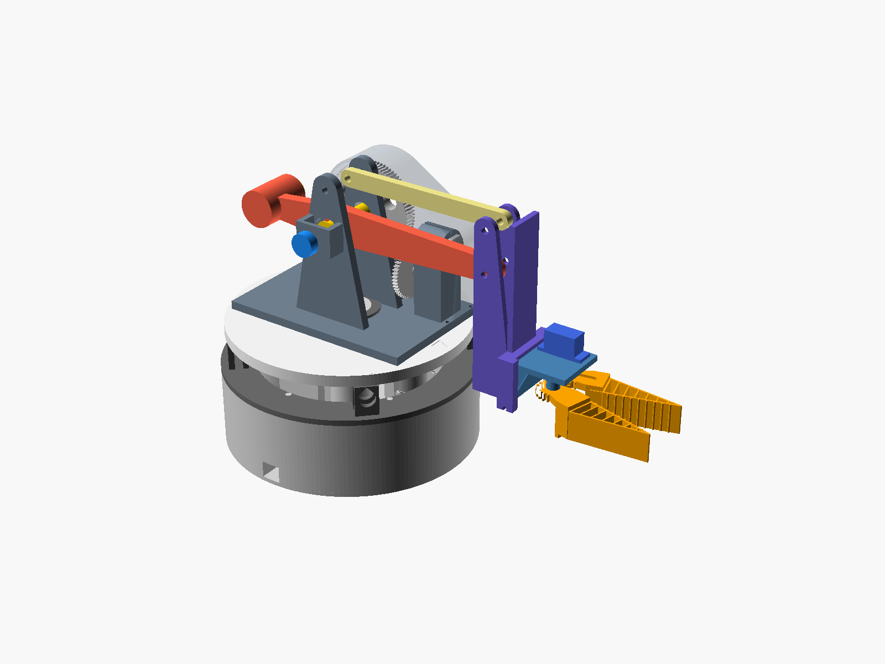

# Roboterarm AM-R1 – Kit-Version

Diese Version braucht **nur das Freenove ESP32-S3 Kit (FNK0082)**, TPU und PLA/PETG. Es werden **keine Schrauben** gekauft. Alles hält über Steckachsen mit Clips, Presspassungen und eine Bajonett-Kappe. Nur die zwei kleinen Schrauben aus dem Beutel des SG90 werden benutzt.

| | Kit-Version | Version 2 (Servos) |
|---|---|---|
| Achsen | Basis, Schulter, Greifer (3) | Basis, Schulter, Ellbogen, Greifer (4) |
| Last | etwa 50–80 g (Holzklotz, Schraubdeckel, Bonbon) | 500 g |
| Kosten | 0 € (nur Filament) | Servos, Netzteil, Schrauben |

Der Arm hat **ein** Gelenk für die Höhe. Ein Parallelogramm hält den Greifer dabei immer **waagerecht**. Deshalb gilt: Je tiefer der Greifer, desto näher ist er an der Basis. Die Firmware rechnet das selbst aus. Du gibst nur Höhe und Drehwinkel vor.



## Was aus dem Kit benutzt wird

| Teil | Wofür |
|---|---|
| ESP32-S3 Board + Steckbrett | Steuerung |
| Schrittmotor 28BYJ-48 + ULN2003-Platine | Basis drehen (±200°) |
| Gleichstrommotor + L293D | Schulter heben und senken |
| Potentiometer 10 kΩ | misst den Schulterwinkel |
| Servo SG90 | Greifer |
| LED + 220 Ω, Fotowiderstand + 10 kΩ | Lichtschranke für den Nullpunkt der Basis |
| Taster | Start / Stopp |
| Steckkabel | Verdrahtung |

Dazu:
- **Strom:** ein USB-Netzteil mit 5 V und mindestens 2 A (Handy-Ladegerät). USB vom PC reicht für Motor und Schrittmotor nicht.
- **15 × 1-Euro-Münzen** als Gegengewicht im Münzmagazin. Die bekommst du zurück.
- **Optional: 6 Lager 6801** (12 × 21 × 5). Wenn du keine hast, druckst du stattdessen 4 `laufrolle` und 2 `lagerbuchse`.

## Greifer zuerst allein testen

Bevor der ganze Arm fertig ist, kannst du den Greifer schon ausprobieren.

**Drucken:** `greifer_teststand`, `greifer_gehaeuse`, `hebel_antrieb`, `hebel_mitlaeufer`, 2 × `klemmplatte`, `finger_tpu_2x` (TPU), 1 × `clip`, `sperrstift`.

**Aufbauen:** Greifer wie in Schritt D bauen. Dann mit dem Servo nach unten von oben in die Schienen des Teststands schieben, bis er aufliegt, und den Sperrstift oben quer durchstecken. Die Finger zeigen nach oben.

**Verdrahten:** nur drei Dinge, die Pins sind dieselben wie später beim Arm:
- SG90: orange an GPIO 41, rot an 5V, braun an GND
- Potentiometer: außen an 3V3 und GND, Mitte an GPIO 1
- Taster: an GPIO 21 und GND

**Firmware:** `firmware/Greifer_Test/Greifer_Test.ino` hochladen.
- Poti drehen: Der Greifer folgt deiner Hand.
- Taster kurz drücken: Auf/Zu-Modus, jeder Druck öffnet oder schließt.
- Taster 1 s halten: zurück zur Steuerung mit dem Poti.
- Im seriellen Monitor: `s` schließt ganz langsam (gut für Eier und Erdbeeren), `d` macht 20 × auf und zu, `a`/`z` legen die Winkel für offen und zu fest.

Probier verschiedene Gegenstände: Ei, Tomate, Schraubdeckel, Stift, Würfel, Schwamm. Gerade bei runden und weichen Teilen siehst du, wie sich die TPU-Finger um die Form legen. Die Winkel, die gut passen, trägst du später in der Arm-Firmware als `GREIFER_AUF` und `GREIFER_ZU` ein.

> Für den Test reicht USB vom PC. Ruckelt der Servo oder startet das Board neu, nimm das 5-V-Netzteil.

## Wie es funktioniert

**Basis:** Der 28BYJ-48 treibt über ein Ritzel mit 15 Zähnen den Zahnkranz am Drehteller mit 75 Zähnen an (1:5). Der Drehteller läuft auf 4 Rollen. Der Nullpunkt wird mit einer Lichtschranke gefunden: Ein halbrunder Rock am Drehteller verdeckt sie auf 180°. Damit weiß der Arm nach jedem Einschalten wieder, wo er steht. Den letzten Winkel speichert er zusätzlich, damit sich das Kabel nicht aufwickelt.

**Schulter:** Der kleine Gleichstrommotor dreht sehr schnell, hat aber kaum Kraft. Deshalb kommen zwei Stufen dazwischen:
1. Stirnrad 10 : 50 (1:5)
2. Schnecke auf Schneckenrad mit 80 Zähnen (1:80)

Das ergibt 1:400. Die Schnecke ist **selbsthemmend**: Wenn der Motor aus ist, bleibt der Arm stehen und sackt nicht ab. Das Potentiometer sitzt direkt auf dem linken Ende der Schulterachse und meldet den Winkel. Die Firmware regelt damit auf ±0,6° genau.

**Gegengewicht:** Hinten am Hauptlenker sitzt ein Rohr für 15 Euro-Münzen (etwa 110 g). Es gleicht das Gewicht von Arm und Greifer aus. So reicht die Kraft des kleinen Motors.

**Greifer:** wie in Version 1, SG90 mit zwei Zahnrad-Hebeln und Fin-Ray-Fingern aus TPU. Er hängt **umgedreht** 80 mm unter dem Handgelenk, damit er bis auf den Tisch kommt.

**Arbeitsbereich**
- Höhe der Greifmitte: etwa 15 mm (Arm ganz unten, φ = −33°) bis 165 mm (φ = +45°)
- Abstand von der Mitte: 185 bis 220 mm
- Drehen: −200° bis +200°

## Druckplatten (Bambu P2S)

In `druckplatten/` liegen alle Teile fertig verteilt auf 256 × 256 mm. Jede Datei ist eine Platte mit einer Einstellung. Einfach in Bambu Studio öffnen: Die Teile bleiben einzelne Objekte und stehen schon richtig.

| Datei | Teile | Einstellung |
|---|---|---|
| `platte_1_basis.3mf` | Basis, Kappe, Münzdeckel, Distanzrohre, Hülsen, Klemmplatten | PLA · 0,2 mm · 3 Wände · 20 % |
| `platte_2_deckelring.3mf` | Deckelring | PLA · 0,2 mm · 3 Wände · 20 % |
| `platte_3_drehteller.3mf` | Drehteller | PETG · 0,2 mm · 4 Wände · 30 % |
| `platte_4_arm.3mf` | Schulterbock, Hauptlenker, Handgelenk, Parallellenker, Getriebedeckel | PETG · 0,2 mm · 4 Wände · 40 % Gyroid · Stützen nur unter dem Poti-Halter |
| `platte_5_zahnraeder.3mf` | Schneckenrad, Schnecke, Ritzel, Achse, Greiferhebel, Steckachsen, Stifte, Clips, Rollenachsen | PETG · 0,12 mm · 100 % · Brim |
| `platte_6_lager_ersatz.3mf` | 4 Laufrollen, 2 Lagerbuchsen | nur ohne Kugellager 6801 |

Die Fin-Ray-Finger (`finger_tpu_2x.stl`) und das Greifergehäuse sind nicht auf den Platten.

## Druckliste

Alle Dateien liegen in `stl/`. Sie liegen schon richtig herum für den Druck.

| Datei | Anzahl | Material | Hinweise |
|---|---|---|---|
| `basis.stl` | 1 | PLA/PETG | 3 Wände, 20 % Füllung |
| `deckelring.stl` | 1 | PLA/PETG | |
| `rollenachse.stl` | 4 | PETG | 100 % Füllung, liegt flach |
| `laufrolle.stl` | 4 | PETG | **nur ohne Lager** |
| `drehteller.stl` | 1 | PLA/PETG | Zahnkranz zeigt nach oben, 4 Wände |
| `ritzel_basis.stl` | 1 | PETG | 100 % |
| `kappe.stl` | 1 | PLA/PETG | Bajonett |
| `schulterbock.stl` | 1 | PETG | 4 Wände, 30 % Gyroid, Stützen nur unter dem Motorhalter |
| `getriebedeckel.stl` | 1 | PLA | |
| `deckelstift.stl` | 3 | PLA | |
| `bockstift.stl` | 4 | PETG | 100 % |
| `achse.stl` | 1 | PETG | liegt flach, 100 % |
| `distanzrohr_2/7/19.stl` | je 1 | PLA/PETG | |
| `lagerbuchse.stl` | 2 | PETG | **nur ohne Lager** |
| `schneckenrad.stl` | 1 | PETG | 0,12 mm Schichthöhe, 100 % |
| `schnecke.stl` | 1 | PETG | stehend, 0,12 mm, 100 %, Brim |
| `motorritzel.stl` | 1 | PETG | 0,12 mm, 100 % |
| `hauptlenker.stl` | 1 | PETG | 4 Wände, 40 % |
| `muenzdeckel.stl` | 1 | PLA | |
| `parallellenker.stl` | 1 | PETG | 100 % |
| `handgelenk.stl` | 1 | PETG | liegt auf der Seite |
| `sperrstift.stl` | 1 | PETG | |
| `greifer_teststand.stl` | 1, optional | PLA | zum Testen des Greifers ohne Arm, Fuß liegt auf dem Bett |
| `steckachse_lang.stl` | 1 | PETG | stehend, 100 % |
| `steckachse_kurz.stl` | 2 | PETG | stehend, 100 % |
| `clip.stl` | 3 | PETG | |
| `clip_gross.stl` | 1 | PETG | |
| `huelse_1/8/11/13/18.stl` | 2/1/1/1/1 | PLA/PETG | |
| `greifer_gehaeuse.stl` | 1 | PLA/PETG | |
| `hebel_antrieb.stl`, `hebel_mitlaeufer.stl` | je 1 | PETG | 100 % |
| `klemmplatte.stl` | 2 | PLA/PETG | |
| `finger_tpu.stl` | 2 | **TPU 95A** | 2 Wände, 0 % Füllung, langsam (30 mm/s) |
| oder `finger_tpu_2x.stl` | 1 | **TPU 95A** | beide Finger in einem Druck |

**Bambu P2S:** Zahnräder, Schnecke und Achsen mit 0,12 mm Schichthöhe drucken, alles andere mit 0,2 mm. TPU aus dem externen Spulenhalter, nicht durch das AMS.

> **Passungen:** Drucke zuerst `steckachse_kurz` und `clip`. Der Clip muss mit leichtem Druck in die Nut schnappen. Ist er zu stramm, in OpenSCAD `stift_d` um 0,1 mm verkleinern und neu exportieren.

## Zusammenbau

### A – Basis
1. **Schrittmotor** von unten in seine Halterung setzen. Die zwei Schnappstifte gehen durch die Ohren und rasten ein. Die Welle zeigt nach oben.
2. **Ritzel** mit 15 Zähnen auf die Welle drücken (Abflachung beachten). Oben muss es 0,5 mm unter dem Drehteller enden.
3. **LED** und **Fotowiderstand** in ihre zwei Löcher stecken. Sie schauen sich durch den Spalt für den Rock an.
4. Die 4 **Rollen** vorbereiten: Lager (oder Laufrolle) auf die Rollenachse schieben. Die Achse mit der flachen Seite nach unten von oben in die Gabel am Deckelring drücken, bis sie einrastet.
5. **Deckelring** auf die 6 Stifte der Basis drücken. Er hält durch die Presspassung.
6. Kabel von Schrittmotor, LED und Fotowiderstand unten durch den Kanal nach außen führen.

### B – Drehteller
1. Den Drehteller über die Mittelsäule setzen. Der Zahnkranz greift ins Ritzel, der Rock läuft durch die Lichtschranke.
2. **Kappe** auf die Mittelsäule setzen. Die zwei Schlitze über die Nocken führen, nach unten drücken und um 40° drehen. Jetzt kann der Drehteller nicht mehr abheben, sich aber frei drehen.

### C – Schulter
1. **Lager** (oder Lagerbuchsen) in die zwei Seitenwände drücken.
2. **Potentiometer** links von außen durch das Loch im Halter stecken und mit seiner Mutter aus dem Kit festziehen.
3. **Schulterachse** von links einschieben. Die Reihenfolge auf der Achse ist:
   - Bund
   - linkes Lager
   - Distanzrohr 7
   - **Hauptlenker** (auf den Sechskant)
   - Distanzrohr 19
   - rechtes Lager
   - Distanzrohr 2
   - **Schneckenrad** (auf den Sechskant)
   - großer Clip in die Nut

   Ganz zum Schluss die Achse kräftig auf die Potentiometerwelle drücken. Vorher das Potentiometer in die Mitte drehen und den Arm waagerecht halten.
4. **Schnecke** von rechts durch die zwei Lagerböcke schieben. Der Bund liegt zwischen den Böcken. Das große Stirnrad sitzt außen rechts.
   Danach die Schnecke ein paar Minuten von Hand am Stirnrad drehen, bis Schnecke und Schneckenrad leicht laufen. Ein Tropfen Öl oder Fett hilft.
5. **Motor** in den Klemmring schieben, bis das Motorritzel ins große Stirnrad greift. Vorher das Motorritzel auf die Motorwelle drücken.
6. Die 15 Münzen ins Münzmagazin stapeln. Die Öffnung zeigt nach links außen. Dann den **Münzdeckel** aufdrücken.
7. **Parallellenker** oben mit der langen Steckachse befestigen. Reihenfolge von links:
   - linke Seitenwand
   - Hülse 18
   - Parallellenker
   - Hülse 8
   - rechte Seitenwand
   - Clip
8. Die 4 **Bockstifte** in den Drehteller stecken und den **Schulterbock** darauf drücken. Die Kabel laufen durch das große Loch in der Grundplatte und die Mittelsäule nach unten.
9. Die 3 **Deckelstifte** in die Löcher der Grundplatte stecken. Den **Getriebedeckel** mit seinen Domen darüberdrücken.

### D – Handgelenk und Greifer
1. **Handgelenk** mit zwei kurzen Steckachsen an Haupt- und Parallellenker befestigen.
   - Unten (Hauptlenker): Platte, Hülse 1, Hauptlenker, Hülse 11, Platte, Clip
   - Oben (Parallellenker): Platte, Hülse 13, Parallellenker, Hülse 1, Platte, Clip
2. Greifer wie in Version 1 bauen:
   - SG90 mit seinen zwei Schrauben ins Greifergehäuse schrauben
   - Antriebshebel auf das Servohorn
   - Mitläufer auf die Achse stecken und den Clip aufsetzen
   - Finger auf die Stifte schieben und die Klemmplatte aufdrücken
3. Den Greifer **umgedreht** (Servo oben) von unten in die Schienen am Handgelenk schieben, bis er oben anschlägt. Dann den **Sperrstift** quer darunter durchstecken.

> Vor dem Einsetzen des Antriebshebels das SG90 mit `s 60` in die Stellung „offen“ fahren. Den Hebel dann so aufsetzen, dass die Finger etwa 40 mm auseinander stehen.

## Verdrahtung

Ausführlicher Plan mit Bildern: siehe `verdrahtung.html` (im Browser öffnen).

> Beim Freenove-Board gehören GPIO 4–13 und 15–18 zur Kamera, 38–40 zur SD-Karte und 35–37 zum Speicher. Deshalb werden nur diese Pins benutzt:

| Bauteil | Anschluss | ESP32-S3 |
|---|---|---|
| L293D Pin 1 (EN1) | | 5V (Kanal immer an) |
| L293D Pin 2 (IN1) | | GPIO 47 |
| L293D Pin 7 (IN2) | | GPIO 42 |
| L293D Pin 3 und 6 | Motor | – |
| L293D Pin 4, 5, 12, 13 und 9 | | GND |
| L293D Pin 8 und 16 | | 5V |
| Potentiometer | außen | 3V3 und GND |
| Potentiometer | Mitte | GPIO 1 |
| SG90 | orange / rot / braun | GPIO 41 / 5V / GND |
| ULN2003 IN1–IN4 | | GPIO 2, 3, 45, 46 |
| ULN2003 + / − | | 5V / GND |
| LED (langes Bein) über 220 Ω | | 3V3, kurzes Bein an GND (leuchtet dauernd) |
| Fotowiderstand | | 3V3 → Fotowiderstand → GPIO 14 → 10 kΩ → GND |
| Taster | | GPIO 21 und GND |

Das 5-V-Netzteil (mindestens 2 A) kommt per USB-C an das Board. Motor, Schrittmotor und Servo nehmen ihren Strom vom 5V-Pin. Für 5V und GND je zwei Kabel parallel stecken.

> Ein Elko (100 µF oder größer) zwischen 5V und GND direkt am L293D verhindert, dass das Board beim Anlaufen des Motors neu startet.

## Firmware

`firmware/Roboterarm_Kit_ESP32S3/Roboterarm_Kit_ESP32S3.ino`
- Arduino IDE, Board **ESP32S3 Dev Module**, Core 3.x
- Bibliotheken **ESP32Servo** und **AccelStepper**
- Serieller Monitor 115200 Baud, Zeilenende „Neue Zeile“

### Erste Inbetriebnahme
1. `m 150` eingeben: Der Arm muss sich **heben**. Senkt er sich, oben `MOTOR_RICHTUNG = -1` setzen.
2. `k` eingeben und der Anleitung folgen: Arm waagerecht, dann 30° hoch. Die Werte werden im ESP32 gespeichert.
3. `l` eingeben und den Drehteller von Hand drehen. Steht der Rock in der Lichtschranke, muss der Wert deutlich kleiner werden. Mit `L <wert>` eine Schwelle zwischen hell und dunkel speichern.
4. `r` macht die Referenzfahrt der Basis.
5. `s 60` / `s 105`: Greifer auf und zu. Die Werte stehen oben als `GREIFER_AUF` und `GREIFER_ZU`.
6. Mit `g <Höhe> <Winkel>` die Punkte A und B anfahren (z. B. `g 12 -90`). Die passenden Werte oben bei `A_unten`, `B_unten` usw. eintragen.
7. Taster oder `a`: Der Ablauf startet. Der Arm holt das Teil bei A, legt es bei B ab und bringt es wieder zurück, immer wieder. Taster noch einmal = Stopp.

Beim Einschalten fährt der Arm zuerst die Schulter auf 20° hoch, sucht dann den Nullpunkt der Basis und fährt in die Parkstellung.

### Schutzfunktionen
- Ändert sich der Schulterwinkel 2 s lang nicht, obwohl der Motor läuft, stoppt alles. Ursache ist eine Blockade oder ein loses Potentiometer.
- Schulter −33° … +45° und Basis −200° … +200° sind Software-Grenzen.
- Der Schrittmotor wird nach jeder Bewegung stromlos geschaltet. Die Zahnräder halten die Basis, er bleibt kühl.

## CAD

`cad/kit.scad` (OpenSCAD). Alle Maße stehen oben. Werte mit `MESSEN` bitte an deinen Kit-Teilen prüfen:
- Motor: Durchmesser, Abflachung, Wellendurchmesser
- Potentiometer: Gewindebuchse, Welle
- Wellenlänge des 28BYJ-48

Ein Teil exportieren:
```
openscad -D 'teil="schulterbock"' -o stl/schulterbock.stl cad/kit.scad
```

## Onshape

`onshape/Roboterarm_Kit.fs` baut die komplette Kit-Version als Feature in Onshape auf, mit Kit-Teilen, Elektronik, Werkstoffen und Mate Connectors. Wie du sie einfügst und animierst, steht in `onshape/ANLEITUNG_ONSHAPE.md`.
